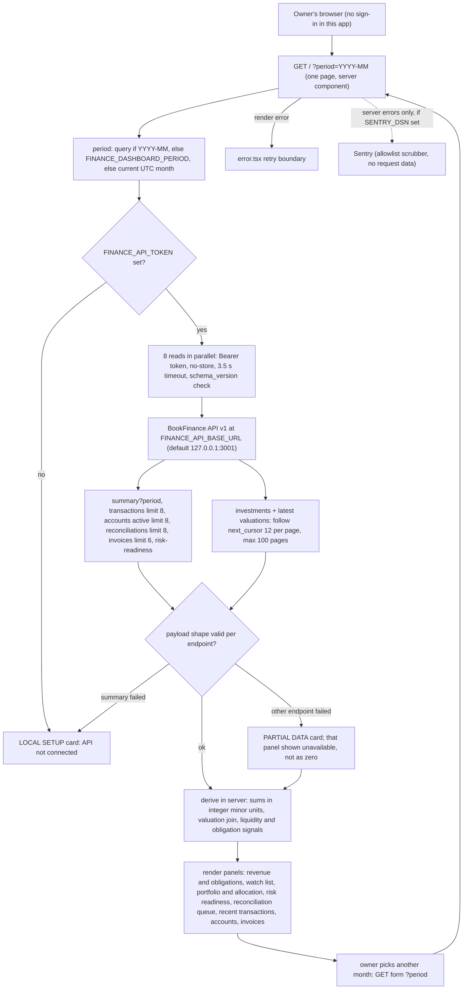

# 01 — Business process (As-Is / To-Be)

finance-portfolio-web (BookPortfolio) คือหน้า dashboard การเงินแบบอ่านอย่างเดียวหน้าเดียวสำหรับเจ้าของคนเดียว: Next.js server component อ่าน BookFinance API v1 ด้วย token ฝั่ง server (`finance:read`) แล้วแสดงกระแสเงินสด ใบแจ้งหนี้ หนี้สิน พอร์ตลงทุน การกระทบยอด และ risk readiness ของเดือนที่เลือก ยังไม่ deploy (รันในเครื่อง)

Last reviewed: 2026-11-27 · commit `cfb15cc`

## As-Is (จากโค้ดวันนี้)

Sources: `app/page.tsx` (`Home`), `src/lib/finance.ts` (`loadFinanceDashboard`, `fetchFinanceEndpoint`, `fetchAllFinancePages`, `resolveReportingPeriod`, `sumMoney`), `app/error.tsx`, `instrumentation.ts`, `src/lib/sentry.ts`, `README.md`, `PRODUCT.md`

ข้อเท็จจริงสำคัญจากโค้ด:

- แอปนี้ไม่มี sign-in ของตัวเอง: ใครเปิดหน้าได้ก็เห็นข้อมูลที่ token อ่านได้ จึงใช้ได้แค่ในเครื่องของเจ้าของ (`PRODUCT.md` §Users) ยังไม่มี deploy config ใน repo
- เขียนข้อมูลไม่ได้เลย: ทุก call เป็น GET ไปที่ `/api/finance/v1/*` เท่านั้น ไม่มี route handler หรือ server action
- ไม่มี token → `fetchFinanceEndpoint` throw ทุก endpoint → summary ล้มเหลว → หน้า LOCAL SETUP (`FINANCE_API_BASE_URL` ที่ไม่ได้ตั้งจะ fallback เป็น `http://127.0.0.1:3001` ไม่ใช่ setup state)
- จำนวนเงินมาจาก API เป็น JSON number (float) แล้วค่อยรวมเป็น minor units ในเว็บ
- บริการที่ตอบ `/api/finance/v1/*` ในวันนี้คืออะไร: README และ product card อ้าง `infra/api/finance.ts` ใน Solo Empire ซึ่งถูก archive ไปแล้ว [ต้องยืนยัน]

## To-Be (จาก `docs/UPGRADE-PLAN.md`, `README.md`)

ไม่มีภาพ To-Be ของกระบวนการทั้งหมด เป้าที่เขียนไว้เป็นรายข้อ:

- `docs/UPGRADE-PLAN.md` P1: Finance API ส่งจำนวนเงินเป็น decimal string หรือ integer minor units และเว็บ parse เป็น minor units ที่ขอบ แทนการเชื่อ `number`
- `docs/UPGRADE-PLAN.md` P1: `tests/page.test.tsx` ครอบคลุม reconciliation queue, risk readiness (`ready` / `blocked`) และพอร์ตหลายสกุลเงิน
- `README.md` §Verification: ก่อนขึ้น production ต้องมี gateway/TLS ที่อนุมัติ, การฉีด secret แบบ managed และ load test จริง
- `README.md` / `PRODUCT.md` §Limits: การแปลงหลายสกุลเงินปิดไว้จนกว่า `finance-fx-snapshot-contract-v1.yaml` จะอนุมัติ; risk metrics ปิดจนกว่า owner รีวิว `finance-risk-metric-definitions-v1.yaml`

## Gap

| ID | As-Is → To-Be | Status | Owner | Evidence |
|---|---|---|---|---|
| G1 | จำนวนเงินมาเป็น JSON float → API ส่ง decimal string / minor units และเว็บ parse ที่ขอบ | todo | claude | `docs/UPGRADE-PLAN.md` P1; types ใน `src/lib/finance.ts` |
| G2 | page test ยังไม่ครอบ reconciliation, risk readiness ready/blocked, หลายสกุลเงิน → มี test ครบ 3 ส่วน | todo | claude | `docs/UPGRADE-PLAN.md` P1; `tests/page.test.tsx` |
| G3 | รันในเครื่องเท่านั้น ไม่มี sign-in และ deploy config → production หลัง gateway/TLS, managed secrets และ load test | decide | owner | `README.md` §Verification, §Boundary status |
| G4 | ไม่แปลงหลายสกุลเงินและไม่คำนวณ risk metric → เปิดเมื่อ FX contract และ metric definitions ผ่านการอนุมัติ | blocked | owner | `README.md` (FX snapshot contract, risk metric definitions) |
| G5 | API ต้นทางที่ README อ้างอยู่ใน Solo Empire ที่ archive แล้ว → ระบุบริการที่ตอบ `/api/finance/v1` วันนี้ หรือย้ายไปอ่าน finance-api | decide | owner | `README.md` §Architecture; `DOCPACK/00-product-card.md` §4 |
| G6 | ไม่มี To-Be ของกระบวนการ (คงไว้, รวมกับ dashboard อื่น หรือเลิก) → owner กำหนด | decide | owner | `DOCPACK/00-product-card.md` §7 (verdict showcase, อาจ merge) |

## Open questions

- BookFinance API v1 (`/api/finance/v1/*`, schema `finance.v1`) ยังรันอยู่ที่ไหน หรือแอปนี้ควรอ่าน finance-api ของ finance cells แทน [ต้องยืนยัน]
- เจ้าของยังใช้หน้านี้อยู่หรือใช้ dashboard อื่นแทน (`DOCPACK/00-product-card.md` §6 [ต้องยืนยัน])
